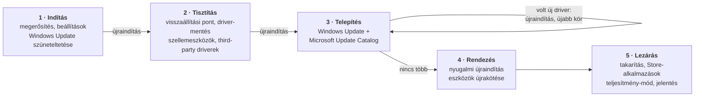
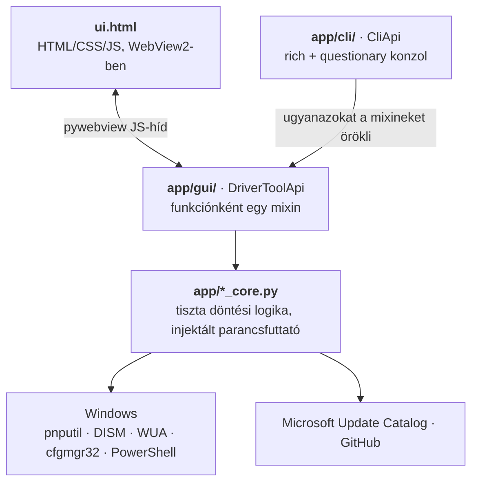

<div align="center">


# DriverVarázsló

### Egy kattintás. Nulláról, gyári driverekkel felszerelt gép. Felügyelet nélkül.

**Windows-driverkezelő és szervizeszköz számítógép-szervizeknek.**<br/>
Letörli a hibás driverkészletet, a gépet a Windows Update-ről és a Microsoft Update Catalogból újradriverezi,<br/>
ellenőrzi, hogy minden eszköz tényleg átvette a drivert, és a végén pontos jelentést ad arról, amit tett.

<br/>

[](https://github.com/egonixaimgod/DriverVarazslo/releases)
[](#-rendszerkövetelmények)
[](#-fejlesztés)
[](#-két-felület-egy-logika)
[](https://github.com/egonixaimgod/DriverVarazslo/commits/main)

<br/>

[**📥 Letöltés**](https://github.com/egonixaimgod/DriverVarazslo/raw/main/dist/DriverVarazslo.exe) &nbsp;·&nbsp;
[Gyors kezdés](#-gyors-kezdés) &nbsp;·&nbsp;
[Funkciók](#-funkciók) &nbsp;·&nbsp;
[Az 1 kattintásos fix](#-az-1-kattintásos-fix) &nbsp;·&nbsp;
[Hibaelhárítás](#-hibaelhárítás) &nbsp;·&nbsp;
[Fejlesztés](#-fejlesztés)

</div>

---

<details>
<summary><b>📑 Tartalomjegyzék</b></summary>
<br/>

- [Miért született?](#-miért-született)
- [Kiemelt tulajdonságok](#-kiemelt-tulajdonságok)
- [Gyors kezdés](#-gyors-kezdés)
- [Funkciók](#-funkciók)
- [Az 1 kattintásos fix](#-az-1-kattintásos-fix)
- [Így talál drivert](#-így-talál-drivert)
- [Biztonság és védőhálók](#-biztonság-és-védőhálók)
- [Két felület, egy logika](#-két-felület-egy-logika)
- [Rendszerkövetelmények](#-rendszerkövetelmények)
- [Hibaelhárítás](#-hibaelhárítás)
- [Naplózás és diagnosztika](#-naplózás-és-diagnosztika)
- [Hálózati kapcsolatok](#-hálózati-kapcsolatok)
- [Architektúra](#-architektúra)
- [Fejlesztés](#-fejlesztés)
- [Jogi tudnivalók](#-jogi-tudnivalók)

</details>

## 💡 Miért született?

Egy szervizbe érkező gép driverkészlete jellemzően **hibás, hiányos, vagy egy másik gépről maradt ott**. A kézi rendbetétel (eszközönként megkeresni, letölteni, feltelepíteni, ellenőrizni) gépenként órákat visz el, és az eredmény a technikus türelmén múlik.

A DriverVarázsló ezt a munkát egyetlen, felügyelet nélkül futó folyamattá teszi:

> **Megnyomod az 1 kattintásos fixet, elmész egy kávéra, és egy hibátlanul feldriverezett géphez térsz vissza, egy összefoglalóval arról, mi települt, mi maradt és miért.**

Laptopon, asztali gépen, gyári és összerakott gépen egyaránt működik: a program nincs gépmodellekre hangolva, a hardver saját azonosítóiból dolgozik.

---

## ✨ Kiemelt tulajdonságok

<table>
<tr>
<td width="33%" valign="top">

### 🚀 Felügyelet nélkül
Kattintás után a program magától végigviszi a törlést, a telepítési köröket és az újraindításokat. Ütemezett feladattal folytatja a munkát minden rendszerindítás után, akkumulátorról is.

</td>
<td width="33%" valign="top">

### 🎯 Két forrás, egy döntés
A **Windows Update Agent** és a **Microsoft Update Catalog** együtt dolgozik. A program a gép saját hardverazonosítóira keres, és a legfrissebb, *ehhez a géphez való* gyári kiadást választja.

</td>
<td width="33%" valign="top">

### ✅ Bizonyíték, nem feltételezés
Sikernek csak az számít, amit a rendszer visszaigazol: az eszköz tényleg átvette a drivert, a beállítás tényleg érvénybe lépett. A visszatérési kód önmagában soha nem verdikt.

</td>
</tr>
<tr>
<td width="33%" valign="top">

### 🔒 Védőhálók
Rendszerindítási útvonal védelme, tároló- és firmware-tiltás, nyomtató- és Wi-Fi-védelem, visszaállítási pont és teljes driver-mentés a törlés előtt.

</td>
<td width="33%" valign="top">

### 💻 GUI és teljes értékű CLI
Modern grafikus felület és egy vele egyenértékű, interaktív parancssoros mód gyenge gépekre. **Ugyanaz a kód** fut mögöttük, a CLI nem lebutított változat.

</td>
<td width="33%" valign="top">

### 📜 Mindent naplóz
Minden parancs, döntés és kattintás bekerül a diagnosztikai naplóba, így egy terepen lefutott javítás utólag is pontosan visszakövethető.

</td>
</tr>
</table>

---

## 📥 Gyors kezdés

1. Töltsd le a legfrissebb **[DriverVarazslo.exe](https://github.com/egonixaimgod/DriverVarazslo/raw/main/dist/DriverVarazslo.exe)**-t, vagy válassz a [kiadások](https://github.com/egonixaimgod/DriverVarazslo/releases) közül (`build-N` címkék).
2. Indítsd el, és fogadd el a rendszergazdai jogosultság kérését. Telepíteni nem kell, egyetlen hordozható `.exe`.
3. A kezdőlapon az **1 kattintásos fix** vár, a többi modul a bal oldali menüből érhető el.

> [!WARNING]
> Az 1 kattintásos fix indítása előtt **kapcsold ki a Windows Defender valós idejű védelmét** (a program kezdőlapján erre külön gomb van). A fix mélyen a rendszerbe nyúl, és egy vírusirtó futás közben megakaszthatja vagy blokkolhatja a műveleteit. Ha ez mégis megtörténik, a program felismeri, és a törlés előtt megáll ([részletek](#-hibaelhárítás)).

> [!TIP]
> A program digitális aláírás nélküli, ezért első indításkor a Windows SmartScreen figyelmeztethet. Ilyenkor: **További információ → Futtatás mindenképp**.

**Indítási kapcsolók**

| Kapcsoló | Hatása |
|---|---|
| `--cli` | A parancssoros felülettel indul |
| `--force-gui` | A grafikus felületet akkor is megpróbálja, ha egy előfeltétel hiányzik, vagy az előző indítás összeomlott |

**Automatikus frissítés:** induláskor a program megnézi a GitHub-kiadásokat és a repó aktuális build-számát, és újabb build esetén felajánlja a frissítést. A letöltött fájl csak akkor kerül a régi helyére, ha átment az ellenőrzésen (teljes méret, érvényes Windows-program, a várt build-szám), így egy hibás letöltés soha nem írja felül a működő verziót. Kézi ellenőrzés: kattintás a bal felső logóra.

---

## 🧭 Funkciók

| Modul | Mire való |
|---|---|
| 🚀 **1 kattintásos driver fix** | A teljes újradriverezés felügyelet nélkül, újraindításokon át ([részletek lent](#-az-1-kattintásos-fix)) |
| 🖥️ **Driver keresés és telepítés** | Kézi szken: minden eszközre megmutatja, van-e újabb gyári driver, és kijelölés után feltelepíti |
| 💿 **Driverek kezelése** | A telepített third-party driverek listája használat szerint, a gép alkatrész-térképével, törléssel és karbantartó eszközökkel |
| 💾 **Mentés és visszaállítás** | Driverek mentése, visszaállítása élő vagy **nem induló** Windowsba, WIM/ESD-kinyerés, rendszerindítás-javítás |
| 🪟 **Operációs rendszer** | Windows Update driverkezelése, Windows és Office aktiválás, BitLocker, teljesítmény-mód, hálózat-blokkoló |
| 🎨 **Kijelző és színkezelés** | HDR, automatikus színkezelés (ACM), ICC-profilok SDR/HDR módra, gamma, panel-adatok, gyári visszaállítás |
| 🧹 **Rendszer karbantartás** | Ideiglenes fájlok, gyorsítótárak és komponenstár takarítása, előre megmutatott méretekkel |
| 🏷️ **Bolti tábla** | A5-ös árlapok a szerviz Word-sablonjából, akciós árral és Windows-telepítés opcióval |
| 🔥 **Stresszteszt** | CPU + memória + GPU teszt (FurMark, Prime95 Small FFTs, Linpack, HWiNFO) egy gombbal, automatizált indítással és ablak-elrendezéssel; **RAM TEST** (TestMem5 → y-cruncher → HCI MemTest felügyelet nélkül, WHEA-figyeléssel és verdikttel) |
| 🧰 **Szervízprogramok könyvtára** | 20 szervizprogram (pl. AIDA64, HD Sentinel, CPU-Z, OCCT, Dism++, MiniTool Partition Wizard, Macrium Reflect, TreeSize, TeraCopy, Total Commander) programonként letöltve, portable indítással vagy telepítve; a licences programok a bolt Drive-járól, jelszóval |
| 🏆 **Benchmark** | Automatikus Cinebench R20 + FurMark mérés, összehasonlítható eredményekkel és felhős ranglistával |
| 📊 **Rendszer riport** | Egyoldalas, nyomtatható hardverriport S.M.A.R.T.-adatokkal |

<details>
<summary><b>🖥️ Driver keresés és telepítés</b></summary>
<br/>

- **Minden jelen lévő eszközre keres.** Kizárva csak az marad, ami nem hardver (kötetek, hangvégpontok, nyomtatósorok), illetve a tároló- és firmware-eszközök.
- **Áttekinthető eredmény:** *Teendő / Hibás / Nem telepíthető / Naprakész / Mind* fülek, a hibakódos eszközök mellett érthető teendővel.
- **A telepített verzió mindenhol látszik:** a felajánlott driver dátuma és verziója a jelenlegi mellett.
- **Két mód:** teljes keresés a Microsoft Update Catalog bevonásával, vagy ⚡ gyors mód csak Windows Update-tel. Külön kapcsolóval a már gyári driveren futó eszközökhöz is keres újabbat.
- **Hibakódos eszközök gyorsjavítása** (engedélyezés, újraindítás) közvetlenül a listából.
- **Store-alkalmazások:** a driverek által kért vezérlőpultokat (pl. NVIDIA Vezérlőpult, Realtek Audio Console, Intel Graphics Command Center) is felismeri és telepíti.
- Az **elrejtett** Windows Update-drivereket megmutatja, de szándékosan nem telepíti: azokat valaki tudatosan tiltotta le.

</details>

<details>
<summary><b>💿 Driverek kezelése</b></summary>
<br/>

- **Használat szerinti besorolás, bizonyítékkal:** *Használatban / Nincs bedugva / Nem fut / Nem használt / Ismeretlen*. A program több független jelből dönt (jelen lévő eszköz, futó kernel-szolgáltatás, bejegyzett nyomtató, szűrő-regisztráció, Extension INF), így a vírusirtók és a távelérés-programok eszköz nélküli driverei sem tűnnek „feleslegesnek”. Ahol nincs elég adat, ott „Ismeretlen” a válasz, nem találgatás.
- **A gép felépítése:** interaktív ábra (laptop vagy asztali gép) arról, melyik driver melyik alkatrészé: videokártya, alaplapi hang, hálózat, chipset, külső eszközök. A döntés a Windows eszközfájából és a PCI-topológiából jön, nem a driver nevéből.
- **Nyomtató-szűrő:** a nyomtató-drivereket az INF tartalmából ismeri fel, akkor is, ha a nyomtató épp nincs a géphez csatlakoztatva.
- **Minden third-party driver törölhető**, offline módban is. Ha egy rossz driver miatt nem indul a gép, egy másik Windowsból indítva pont azt a csomagot lehet eltávolítani. A Windows saját (inbox) drivereihez a program szándékosan nem nyúl.
- **Karbantartás:** elavult duplikátumok takarítása a DriverStore-ból (a legfrissebb kiadás marad, a használatban lévő soha nem törlődik), szellemeszközök eltávolítása, eszközök újrakötése a gyári driverre.
- **Bluetooth tiszta lap:** minden Bluetooth-párosítás és -eszköz törlése egy lépésben, a Windows párosítás-adatbázisával együtt. Ha a Bluetooth-rádió hibás állapotban van, a program a végén megjavítja.
- A lista minden feladat után magától frissül, ha közben változott a DriverStore. Offline módban a céllemez mindenhol fel van tüntetve.

</details>

<details>
<summary><b>💾 Mentés, visszaállítás és offline javítás</b></summary>
<br/>

- Teljes driver-mentés és visszaállítás, régi mentésekből is.
- **Offline mód:** a program egy másik Windowsból vagy WinPE-ből indítva a sérült telepítés driverein dolgozik (`dism /Image`). A driverlista mindig a saját lemezéhez kötött, így egy lemezváltás után sem törölhet rossz helyről.
- Driverek kinyerése **WIM/ESD** telepítőképekből.
- Rendszerindítás (BCD) automatikus javítása offline visszaállítás után.
- Visszaállítási pont létrehozása egy kattintással.

</details>

<details>
<summary><b>🪟 Operációs rendszer</b></summary>
<br/>

- **Windows Update:** automatikus driverfrissítés tiltása és visszaállítása, szüneteltetés, gyorsítótár-törlés, visszaolvasott eredménnyel.
- **Windows és Office aktiválás:** licencállapot közvetlenül WMI-ből, a **BIOS-ba égetett gyári kulcs** kiolvasása és használata, KMS-tartalék a szerviz saját kiszolgálójával. A végeredményt a program a rendszertől kérdezi vissza.
- **BitLocker:** a rendszermeghajtó állapota és a titkosítás kikapcsolása.
- **⚡ Teljesítmény-mód:** a beépített „Nagy teljesítményű” energiaséma hangolt értékekkel (hálózatról és akkumulátorról is), a régi séma megnevezésével és a visszaállítás parancsával.
- **Hálózat-blokkoló szkript** letöltése tűzfal-alapú internettiltáshoz.

</details>

<details>
<summary><b>🎨 Kijelző és színkezelés</b></summary>
<br/>

- HDR és automatikus színkezelés (ACM) kapcsolása kijelzőnként, a Windows DisplayConfig API-ján át.
- ICC-profilok hozzárendelése **külön SDR és HDR módra**, és annak megjelenítése, melyik profil fut ténylegesen.
- A panel adatai az EDID-ből: csúcsfényerő, fekete szint, színtér (a gyártó által közölt értékek).
- A videokártya gamma-görbéjének kiolvasása és ábrázolása: ez az egyetlen közvetlen bizonyíték arra, hogy valami módosítja-e a képet.
- Profilkönyvtár, árva hozzárendelések javítása, bejelentkezéskor érvényesülő tiltások, és **teljes gyári visszaállítás** előnézettel.

</details>

<details>
<summary><b>🔥 Stresszteszt, szervizprogramok és benchmark</b></summary>
<br/>

- **Stresszteszt egy gombbal:** FurMark, Prime95, Linpack Xtreme és HWiNFO64 indul, a program automatikusan megválaszolja az indítóablakokat, majd a négy ablakot a képernyő négy negyedébe rendezi. A Prime95 Small FFTs módban fut (maximális CPU-hő), a memóriát a Linpack terheli; alapos memóriateszthez a RAM TEST való.
- **RAM TEST (zöld gomb):** TestMem5 (anta777 Extreme), y-cruncher (FFTv4 + VT3) és HCI MemTest (szálanként egy példány) egymás után, felügyelet nélkül, Gyors vagy Teljes módban. Közben és a végén a WHEA-hibanaplót is figyeli, a végén kiírja a verdiktet és a teendőt. Stabilnak csak akkor mondja a gépet, ha mindhárom teszt hibátlan és a WHEA-napló tiszta. A képernyő-elalvás a teszt idejére kikapcsol, utána visszaáll. A Linpack a WMIC nélküli Windows 11-en (24H2+) is elindul, a hiányzó összetevő letöltése nélkül.
- **Szervízprogramok könyvtára (külön menüpont):** minden program külön töltődik le, csak az, amelyiket elindítod vagy telepíted. Portable indítás vagy telepítés a Program Files (x86) alá, asztali parancsikonnal; törlés egy kattintással. A licences programok a bolt Google Drive-járól jönnek, jelszóval.
- **Benchmark:** Cinebench R20 többmagos teszt és FurMark mérés rögzített beállításokkal. A FurMark háromszor fut, a legjobb számít, a kép pontosan 1024×768-ban renderelődik minden gépen, így az eredmények valóban összehasonlíthatók.
- **Felhős ranglista** gépenkénti bejegyzésekkel.

> A harmadik féltől származó programok programonként külön csomagban, első használatkor töltődnek le, és a saját licencük vonatkozik rájuk.

</details>

<details>
<summary><b>📊 Riport, nyomtatás és karbantartás</b></summary>
<br/>

- **Rendszer riport:** CPU, RAM (a gyártót a modul cikkszámából is felismeri), videokártya valódi VRAM-mérettel, alaplap, háttértárak S.M.A.R.T.-adatokkal. Mindig egy oldalra fér, és egy kattintással a szerviz nyomtatójára küldhető. A teszt-SSD-ről futtatott programnál a rendszerlemez kihagyható.
- **Bolti tábla:** két gép A5-ös árlapja a szerviz saját Word-sablonjából, előre kitöltött mezőkkel. Ha egy mező túl hosszú a laphoz, a felület megmutatja, melyik, és mennyi fér ki.
- **Rendszer karbantartás:** ideiglenes fájlok, Windows Update- és kézbesítés-optimalizálási gyorsítótár, hibajelentések, böngésző-gyorsítótárak (csak a gyorsítótár: süti, jelszó, előzmény nem), Lomtár, komponenstár. Kategóriánkénti méret előre, a felszabadult hely utólag mérve.

</details>

---

## 🚀 Az 1 kattintásos fix

A fix **nem menti el és nem teszi vissza** a gép régi drivereit: azok jellemzően épp a hiba okai. Helyette mindent letöröl, amit a technikus nem jelölt megtartandónak, és a gépet **nulláról** driverezi újra, megbízható forrásokból.



**A megerősítő ablakban a technikus dönt**, és ezek a döntések minden újraindításon át érvényben maradnak:

| Beállítás | Hatása |
|---|---|
| **Törlési előnézet** | Minden törlendő csomag látszik, azzal együtt, *mire való* és *használja-e most a gép*; csomagonként kivehető |
| **Nyomtató-driverek megtartása** | A gép nyomtatói a szerviz után is működnek, akkor is, ha épp nincsenek csatlakoztatva |
| **Wi-Fi mód** | Kábel nélküli gépen a hálózat végig megmarad: a Wi-Fi driver nem törlődik, a mentett hálózatok (titkosítva) visszaállnak, a gép automatikusan visszacsatlakozik |
| **Wi-Fi driver újraépítése** | A Wi-Fi adapter beállításai tiszta lapról épülnek fel, a mentett hálózat automatikus visszaállításával |
| **Teljes / gyors keresés** | A Microsoft Update Catalog bevonása vagy kihagyása |
| **Windows Update szüneteltetése** | A frissen felrakott, összehangolt driverkészletet a Windows ne írja felül napokkal később |

**A lezáró lépések:** a régi, kiváltott driverek eltávolítása a DriverStore-ból · a driverekhez tartozó Store-alkalmazások telepítése · teljesítmény-centrikus energiaséma · zárójelentés arról, mi települt, mi maradt Windows-alapdriveren és miért, valamint mely korábbi csomagok nem kerültek vissza.

> [!NOTE]
> A lánc akkor ér véget, amikor egy telepítési kör **már nem talál új drivert**, nem egy előre rögzített lépésszámnál. Egy biztonsági felső korlát ettől függetlenül megakadályozza, hogy egy rendellenes gép végtelen körbe kerüljön. A záró jelentés ezután egy frissen újraindított gépen készül, így azt mutatja, ami a következő indításkor is igaz.

---

## 🔎 Így talál drivert

Minden eszközön ugyanaz a döntési lánc fut le, a kézi szkenben és az 1 kattintásos fixben egyaránt, **ugyanazzal a kóddal**.

| # | Lépés | Mit biztosít |
|:-:|---|---|
| 1 | **Eszközfelmérés** | Minden jelen lévő eszköz, az összes hardverazonosítójával. Kizárás csak a nem-hardver objektumokra és a tároló/firmware eszközökre. |
| 2 | **Windows Update Agent** | A Microsoft szerveroldali, erre a gépre célzott ajánlata. |
| 3 | **Microsoft Update Catalog** | Keresés a gép *specifikus* azonosítóira, dátum szerint rendezett lapozással, operációs rendszer és architektúra szerinti pontozással. Típuskódra (ami bármely gyártó csomagját behozná) nem keres. |
| 4 | **Kiadás-kapu** | Csak újabb kiadás mehet fel; gyári driveren futó eszközt soha nem léptet vissza. Windows-alapdriveren álló eszköznél a régebbi gyári driver is jobb a semminél. |
| 5 | **Letöltés előtti ellenőrzés** | A katalógus saját adatlapja szerint támogatja-e a csomag *ezt* az eszközt. Egy másik gépgyártó változata így letöltés nélkül kiesik. |
| 6 | **INF-vizsgálat** | A kicsomagolt driver valóban illik-e az eszközre és a telepített Windows-verzióra; csak az illeszkedő INF-ek kerülnek fel. |
| 7 | **Kötés-ellenőrzés** | Az eszköz tényleg átvette-e a drivert. Ha nem, a program a következő jelöltet próbálja, és megjegyzi a kudarcot. |
| 8 | **Őszinte zárás** | Ha egy eszközhöz tényleg nincs csomag, azt a program **néven nevezi**, a teendővel együtt. „Nincs driver” csak akkor hangzik el, ha minden jelöltet bizonyítottan végigpróbált. |

---

## 🔒 Biztonság és védőhálók

| Védelem | Mit jelent a gyakorlatban |
|---|---|
| **Rendszerindítási útvonal** | A rendszerlemez eszközláncán lévő drivert a fix nem törli: egy hibás tárolóvezérlő-csere a gépet indíthatatlanná tenné. |
| **Tároló és firmware** | Tárolóvezérlő-drivert és firmware-t a program automatikusan **soha** nem telepít: ezek hibája helyreállító hordozót vagy hardvercserét igényelhet. |
| **Visszaállítási pont + driver-mentés** | A törlés előtt mindkettő elkészül, kézi mentsvárként. |
| **Visszaléptetés-védelem** | Működő gyári driver helyére régebbi kiadás nem kerül. |
| **Visszaolvasott verdikt** | Törlés, telepítés, aktiválás, energiaséma, Windows Update-beállítás: az eredményt mindig a rendszer tényleges állapotából olvassa vissza. |
| **A nem tudás nem tény** | Egy elbukott lekérdezés nem „üres eredmény”: ha a program valamit nem tudott ellenőrizni, azt kimondja, és nem töröl vagy jelent sikert rá alapozva. |
| **Vírusirtó-felismerés** | Ha egy vírusirtó megakasztja a törlés előtti mentést, a program kideríti, mi blokkol, és a törlés előtt megáll. |
| **Megszakíthatóság** | A megszakítás az újraindítás előtti türelmi időben is érvényes, és a folytatásra ütemezett feladat is törlődik. |
| **Hálózat-tudatosság** | A folytatás megvárja a hálózatot (névfeloldással együtt), és kapcsolat nélkül semmit nem töröl. |

> [!IMPORTANT]
> A DriverVarázsló rendszerszintű változtatásokat végez (driverek törlése és telepítése, rendszerbeállítások módosítása). Szerviz- és rendszergazdai használatra készült; fontos adatokat tartalmazó gépen a futtatás előtt készíts biztonsági mentést.

---

## 💻 Két felület, egy logika

| | Grafikus felület | Parancssoros mód (CLI) |
|---|---|---|
| **Technológia** | pywebview + Microsoft Edge WebView2, sötét „glassmorphism” téma | `rich` + `questionary`: nyilas menük, szóközzel pipálható listák, táblázatok, folyamatjelzők |
| **Mikor** | alapértelmezés minden modern gépen | gyenge gépen, illetve ha a WebView2 vagy a .NET nem érhető el |
| **Funkciók** | a teljes eszközkészlet | ugyanaz: a CLI a grafikus felület moduljait hívja |
| **Váltás** | az oldalsáv **🖥️ CLI mód** gombja (a build-szám alatt) | a főmenü **Grafikus mód** pontja, vagy `DriverVarazslo.exe --cli` |

Ha a grafikus felület egy gépen nem tud elindulni, a program ezt a következő indításkor felismeri, és magától a parancssoros módot hozza fel. Ha a terminál nem tud interaktív menüt rajzolni, a CLI számozott, begépelős módra vált.

---

## 📋 Rendszerkövetelmények

| | Követelmény |
|---|---|
| **Operációs rendszer** | Windows 10 (1607 vagy újabb) / Windows 11, 64 bites. Windows 8.1 és régebbi rendszeren a program nem indul el. |
| **Jogosultság** | Rendszergazda (a program UAC-kéréssel magától emeli a jogosultságát) |
| **Grafikus felülethez** | Microsoft Edge WebView2 Runtime és .NET Framework 4.7.2+. Hiányuk esetén a program felajánlja a telepítésüket, addig a parancssoros mód működik. |
| **Driverkereséshez** | Internetkapcsolat (Windows Update, Microsoft Update Catalog) |
| **Telepítés** | Nincs, egyetlen hordozható `.exe` |

---

## 🩺 Hibaelhárítás

<details>
<summary><b>A Windows SmartScreen nem engedi elindítani</b></summary>
<br/>

A program nincs digitálisan aláírva. **További információ → Futtatás mindenképp.**

</details>

<details>
<summary><b>A fix a törlés előtt megállt, vírusirtóra hivatkozva</b></summary>
<br/>

A törlés előtti driver-mentést egy vírusirtó megakasztotta. A program ilyenkor nem vár órákig: az első beragadás után leállítja a további mentéseket, és kideríti az okot. Ha a Windows Defender bizonyítottan blokkolt, vagy egy másik vírusirtó fut a gépen, a lánc **a törlés előtt** megáll, mert egy blokkolt gépen a törlés lemenne, a telepítés viszont nem. Kapcsold ki a valós idejű védelmet (vagy ideiglenesen távolítsd el a vírusirtót), és indítsd újra a fixet.

</details>

<details>
<summary><b>Az ablak pár másodperc után fehér vagy fekete lesz</b></summary>
<br/>

Ha a napló hibátlan, ezt szinte mindig egy, a WebView2-be beinjektált idegen program okozza. Mérten ilyen a **RivaTuner Statistics Server (RTSS)** overlay-e. Zárd be az overlay-programot, és indítsd újra a DriverVarázslót. Ha sürgős, a `--cli` kapcsolóval a parancssoros mód azonnal használható.

</details>

<details>
<summary><b>A grafikus felület helyett a parancssoros mód jön fel</b></summary>
<br/>

Az előző indításkor a grafikus felület nem tudott elindulni (jellemzően hiányzó .NET Framework 4.7.2+ vagy WebView2 miatt). Telepítsd a hiányzó összetevőt, vagy próbáld a `--force-gui` kapcsolóval. A CLI-ből a főmenü **Grafikus mód** pontja is visszavisz.

</details>

<details>
<summary><b>Egy eszköz a fix után driver nélkül maradt</b></summary>
<br/>

A zárójelentés az ilyen eszközt név szerint felsorolja, a pontos teendővel. „Nincs hozzá driver” csak akkor szerepel, ha a program a Windows Update-et és a katalógus minden jelöltjét bizonyítottan végigpróbálta. A részletes döntési láncot (milyen kulccsal keresett, melyik csomag nyert, miért esett ki) a napló tartalmazza.

</details>

<details>
<summary><b>Hol találom a naplót, és hogyan küldöm el?</b></summary>
<br/>

`%SystemDrive%\DriverVarazslo\DriverVarázsló_debug.log`. A lánc végén és a kézi telepítés végén a program a naplót a szerviz felhőtárhelyére is feltölti; a felületen a **Naplók** résznél kezelhető.

</details>

---

## 📜 Naplózás és diagnosztika

A DriverVarázsló hibajelentése maga a napló. Egy szervizben lefutott javítás után a gép már az ügyfélnél van, és amit a napló nem rögzített, az utólag nem deríthető ki.

- **Hely:** `%SystemDrive%\DriverVarazslo\DriverVarázsló_debug.log` (rotálva, legfeljebb 3 × 5 MB, UTF-8)
- **Tartalom:** minden külső parancs a kimenetével és visszatérési kódjával, minden döntés *a bemenetével együtt* (melyik csomag, melyik eszköz, melyik telepített verzióhoz képest), minden szűrő azzal, amit kiszűrt, és minden felhasználói kattintás vagy CLI-bevitel.
- **Szálbiztos:** a párhuzamos munkaszálak sorai a szál nevével azonosíthatók.
- **Gépenként külön:** minden naplófájl első sora megnevezi a gépet (típus + sorozatszám). Ha ugyanazt a lemezt egy másik gépbe kötöd, az előző gép naplója a `naplok_korabbi_gepek` mappába kerül, és a mostani gép tiszta naplóval indul.
- **Felhő-szinkron:** a futások naplói gépenként és futásonként, dátum szerint rendezve kerülnek a szerviz tárhelyére. A letöltéshez jelszó kell, és időszak szerint szűrhető (ma / 7 nap / 30 nap / 1 év / összes).

---

## 🌐 Hálózati kapcsolatok

Átláthatóság kedvéért: a program kizárólag az alábbi szolgáltatásokkal kommunikál.

| Cél | Mire |
|---|---|
| Windows Update / Microsoft Update | driverkeresés és -telepítés |
| `catalog.update.microsoft.com` | driverkeresés a Microsoft Update Catalogban |
| Microsoft Store | a driverekhez tartozó alkalmazások |
| `github.com` | programfrissítés, a szervizprogram-csomag és az aktiváló csomag letöltése |
| A szerviz saját felhővégpontja | diagnosztikai napló és benchmark-ranglista |

Minden letöltés tanúsítvány-ellenőrzéssel történik; ez semmilyen tartalék útvonalon sincs kikapcsolva.

---

## 🧱 Architektúra



```text
DriverVarazslo/
├── driver_tool.py           # belépési pont: jogosultság, előfeltételek, naplózás, GUI/CLI indítása
├── ui.html                  # a teljes grafikus felület (HTML/CSS/JS, keretrendszer és build nélkül)
├── app/
│   ├── *_core.py            # a funkciók logikája, közös a GUI és a CLI számára
│   ├── win32.py             # Win32/ctypes: eszközfa (cfgmgr32), DisplayConfig, rendszerhívások
│   ├── common.py            # közös infrastruktúra: parancsfuttatás, letöltés, naplózás
│   ├── gui/                 # a grafikus felület API-ja, funkciónként egy modul
│   └── cli/                 # parancssoros felület: menü, konzol-megjelenítés, esemény-híd
├── tests/                   # offline regressziós tesztkészlet
├── docs/terep/              # terepi bizonyítékok: mérések, naplórészletek, döntések indoklása
├── DriverVarazslo.spec      # PyInstaller build-leírás
└── dist/DriverVarazslo.exe  # a kiadott program (az automatikus frissítés forrása)
```

**Tervezési elvek**

- **Egy logika, két felület.** Minden funkció magja egy `app/<funkció>_core.py` modulban él; a grafikus és a parancssoros felület csak megjeleníti az eredményt.
- **Tesztelhető mag.** A core modulok nem indítanak közvetlenül külső folyamatot: a parancsfuttatót paraméterként kapják, így a döntési logika valós terepi adatokon, hálózat és rendszerváltoztatás nélkül tesztelhető.
- **A verdikt a visszaolvasás.** Egy művelet csak akkor sikeres, ha a rendszer állapota ezt visszaigazolja.
- **Nincs néma hiba.** Elnyelt kivétel, jelzés nélküli szűrő vagy megmagyarázatlan kihagyás nincs a kódban.
- **Óraugrás-biztos időmérés.** Időtúllépések és mérések monoton órával: egy rendszeróra-szinkronizálás futás közben sem téveszti meg a programot.

---

## 🔧 Fejlesztés

**Előfeltételek:** Windows 10/11, Python 3.12, rendszergazdai jogosultság.

```bash
pip install pywebview pyinstaller pyflakes rich==14.1.0 questionary==2.1.1

python driver_tool.py          # indítás forrásból (grafikus felület, UAC-vel emel)
python driver_tool.py --cli    # indítás forrásból (parancssoros mód)
```

**Ellenőrzés** (minden változtatás után)

```bash
export PYTHONIOENCODING=utf-8                 # különben az első emojis kiírás elszáll cp1252-n
python -m unittest discover -s tests -v      # offline regressziós tesztek, hálózat és rendszerváltoztatás nélkül
python -m pyflakes app/ driver_tool.py       # statikus névellenőrzés
python -c "import app.gui.api, app.cli.api"  # a két API-osztály összeáll-e
```

A tesztkészlet a terepi naplókból vett nyers adatokon hajtja meg a döntési logikát: katalógus-döntés (szabály-fuzzal), HWID-párosítás, a lánc lábainak sorrendje és állapota, a törlő funkciók igazmondása, frissítés, mentés, kijelző, CLI-konzol és stresszteszt-ablakkezelés.

**Build**

```bash
python -m PyInstaller --clean --noconfirm DriverVarazslo.spec   # -> dist/DriverVarazslo.exe
```

| Szkript | Mit csinál |
|---|---|
| `build.bat` | build-szám emelése + exe fordítása |
| `rebuild_verzioszam_novelessel_es_github_pushal.bat` | teljes kiadás: build-szám emelése, fordítás, commit, push és `build-N` GitHub-kiadás, visszaolvasással |

> [!CAUTION]
> A `main` ágra küldött exe a terepen futó példányok automatikus frissítésének forrása: egy push éles kiadásnak számít. A build-szám soha nem csökkenhet.

**Hozzájárulás:** a projekt szabálykönyve a [`CLAUDE.md`](CLAUDE.md), a döntések bizonyítékai (mérések, terepi naplórészletek) a [`docs/terep/`](docs/terep) mappában vannak. Egy szabály megváltoztatása előtt olvasd el a hozzá tartozó bizonyítékot; egy új javításhoz új teszt jár.

---

## 📄 Jogi tudnivalók

**Felelősség:** a programot a szerző a legjobb tudása szerint készítette, de a használata saját felelősségre történik. Driverek és rendszerbeállítások módosítása minden esetben kockázattal jár.

**Harmadik fél programjai:** a stressztesztelő, benchmark- és diagnosztikai programok (FurMark, Prime95, Linpack Xtreme, HWiNFO, TestMem5, y-cruncher, HCI MemTest, Thaiphoon Burner, HD Sentinel, CPU-Z, GPU-Z, ZenTimings, NVIDIA Profile Inspector, Cinebench, smartctl, SumatraPDF) nem részei ennek a repónak; a saját licencük vonatkozik rájuk. A Windows, a Windows Update és a Microsoft Update Catalog a Microsoft Corporation védjegyei és szolgáltatásai.

**Licenc:** a projekthez jelenleg nem tartozik nyílt forráskódú licenc, minden jog fenntartva.

<div align="center">
<br/>
<sub>Számítógép-szervizek technikusainak készült · Magyar nyelvű felület · Windows 10 / 11</sub>
</div>
